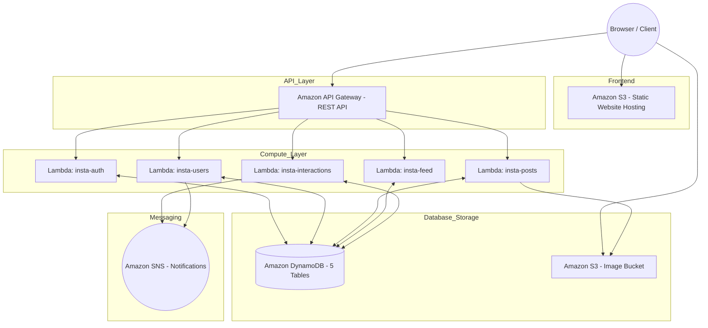

# InstaClone — Instagram-Like Serverless Social Media Application

## Project Overview

InstaClone is a full-stack, serverless social media application inspired by Instagram. Built using AWS services, this Capstone project demonstrates a practical implementation of cloud-native architecture, serverless computing, NoSQL database design, secure storage, authentication, and RESTful API development.

The application allows users to create accounts, manage profiles, share image posts, follow other users, interact with posts, and receive notifications.

## Key Features

- **User Authentication:** Secure signup and login using JWT authentication.
- **User Profiles:** Customizable profiles featuring a bio, avatar, and follower/following counts.
- **Content Creation:** Create posts with image uploads securely handled via S3 pre-signed URLs.
- **Personalized Feed:** Dynamically generated home feed displaying posts from followed users.
- **Social Interactions:** Like, unlike, and comment on posts.
- **Follow System:** Follow and unfollow other users.
- **User Search:** Search for users by username or full name.
- **Event Notifications:** SNS notifications triggered for likes, comments, and follows.

## AWS Services Used

| AWS Service        | Purpose                                                                    |
| ------------------ | -------------------------------------------------------------------------- |
| Amazon S3          | Hosts the static frontend application and stores user-uploaded images.     |
| Amazon API Gateway | Provides REST API routing for client requests to Lambda functions.         |
| AWS Lambda         | Executes serverless Node.js backend logic without provisioning servers.    |
| Amazon DynamoDB    | Stores users, posts, likes, comments, and follow relationships.            |
| Amazon SNS         | Manages publish/subscribe notifications for social interactions.           |
| Amazon CloudWatch  | Monitors application health and stores Lambda execution logs.              |
| Amazon Route 53    | Manages DNS routing and custom domain configuration (optional).            |
| Amazon VPC         | Provides an isolated network environment for backend execution (optional). |

## Live Demo

🚀 **[Visit InstaClone](http://www.santhosh-cloud.tech)**

## Application Screenshots

### 1. Login Page


### 2. Home Feed


### 3. User Profile


### 4. Create Post


### 5. Social Interactions


## Architecture

The application follows a decoupled, event-driven serverless architecture.

1. The client requests the frontend application hosted on an Amazon S3 bucket.
2. The frontend communicates with the backend through Amazon API Gateway (REST API).
3. API Gateway routes requests to specific AWS Lambda functions.
4. Lambda functions interact with DynamoDB for database operations.
5. For image uploads, Lambda generates a pre-signed URL, allowing the client to upload images directly to Amazon S3.
6. Social interactions trigger events published to Amazon SNS for asynchronous notifications.

### Architecture Diagram



## Technology Stack

| Category        | Technology                      |
| --------------- | ------------------------------- |
| Frontend        | HTML5, CSS3, Vanilla JavaScript |
| Backend Runtime | Node.js 24.x                    |
| Compute         | AWS Lambda                      |
| API Layer       | Amazon API Gateway (REST)       |
| Database        | Amazon DynamoDB                 |
| Storage         | Amazon S3                       |
| Messaging       | Amazon SNS                      |
| Monitoring      | Amazon CloudWatch               |

## Project Structure

```text
InstaClone/
│
├── backend/
│   ├── functions/
│   │   ├── auth/
│   │   │   ├── index.js
│   │   │   ├── package.json
│   │   │   └── utils/
│   │   ├── users/
│   │   │   ├── index.js
│   │   │   ├── package.json
│   │   │   └── utils/
│   │   ├── posts/
│   │   │   ├── index.js
│   │   │   ├── package.json
│   │   │   └── utils/
│   │   ├── feed/
│   │   │   ├── index.js
│   │   │   ├── package.json
│   │   │   └── utils/
│   │   └── interactions/
│   │       ├── index.js
│   │       ├── package.json
│   │       └── utils/
│   │
│   └── schema/
│       └── tables.json
│
└── frontend/
    ├── index.html
    ├── login.html
    ├── signup.html
    ├── profile.html
    ├── create.html
    ├── post.html
    │
    ├── css/
    │   └── style.css
    │
    └── js/
        ├── config.js
        ├── api.js
        ├── auth.js
        └── ...
```

### Backend Architecture

The backend consists of five separate AWS Lambda functions. Each function handles a specific application domain.

| Lambda Function    | Responsibility                             |
| ------------------ | ------------------------------------------ |
| insta-auth         | User registration and login                |
| insta-users        | User profiles, follow/unfollow, and search |
| insta-posts        | Post management and S3 pre-signed URLs     |
| insta-feed         | Personalized feed generation               |
| insta-interactions | Likes and comments                         |

Each function includes its own utilities and dependencies. API Gateway routes HTTP requests to the appropriate Lambda function, which processes requests, validates JWT authorization where required, and interacts with DynamoDB, S3, and SNS.

### Frontend

The frontend is built using HTML, CSS, and Vanilla JavaScript.

It is hosted as a static website on Amazon S3. The application manages user authentication state and dynamically renders the interface by communicating with API Gateway using the Fetch API.

Main frontend pages:

- Home Feed
- Login
- Signup
- User Profile
- Create Post

### Database Design

The application uses Amazon DynamoDB with five core tables.

| Table         | Partition Key  | Sort Key        | Global Secondary Indexes     |
| ------------- | -------------- | --------------- | ---------------------------- |
| InstaUsers    | userId (S)     | —               | email-index, username-index  |
| InstaPosts    | postId (S)     | —               | userId-createdAt-index       |
| InstaLikes    | postId (S)     | userId (S)      | —                            |
| InstaComments | postId (S)     | commentId (S)   | —                            |
| InstaFollows  | followerId (S) | followingId (S) | followingId-followerId-index |

Refer to `backend/schema/tables.json` for the table definitions.

## API Documentation

The application exposes RESTful API endpoints through Amazon API Gateway.

| Method       | Endpoint                    | Purpose                           | Lambda Function    |
| ------------ | --------------------------- | --------------------------------- | ------------------ |
| POST         | `/api/auth/signup`          | Register a new user               | insta-auth         |
| POST         | `/api/auth/login`           | Authenticate user and issue JWT   | insta-auth         |
| GET          | `/api/users/search`         | Search users by name or username  | insta-users        |
| GET, PUT     | `/api/users/{id}`           | Get or update user profile        | insta-users        |
| POST, DELETE | `/api/users/{id}/follow`    | Follow or unfollow a user         | insta-users        |
| GET          | `/api/users/{id}/followers` | List user's followers             | insta-users        |
| GET          | `/api/users/{id}/following` | List users the user follows       | insta-users        |
| GET          | `/api/users/{id}/posts`     | Fetch a user's posts              | insta-posts        |
| GET          | `/api/posts/upload-url`     | Generate S3 pre-signed upload URL | insta-posts        |
| POST         | `/api/posts`                | Create a new post                 | insta-posts        |
| GET, DELETE  | `/api/posts/{id}`           | Retrieve or delete a post         | insta-posts        |
| POST, DELETE | `/api/posts/{id}/like`      | Like or unlike a post             | insta-interactions |
| GET, POST    | `/api/posts/{id}/comments`  | Fetch or add a comment            | insta-interactions |
| DELETE       | `/api/comments/{id}`        | Delete a specific comment         | insta-interactions |
| GET          | `/api/feed`                 | Retrieve personalized user feed   | insta-feed         |

## S3 Configuration

The application uses two Amazon S3 buckets.

**1. Frontend Hosting Bucket**

- Configured for static website hosting.
- Stores frontend HTML, CSS, and JavaScript files.
- Uses a bucket policy allowing public read access to website files, where required.

**2. Image Storage Bucket**

- Stores user-uploaded images.
- Uses pre-signed URLs for direct image uploads.
- CORS is configured to allow the required PUT and GET methods from the frontend domain.

## Lambda Deployment

The backend uses five AWS Lambda functions.

| Configuration | Value                   |
| ------------- | ----------------------- |
| Runtime       | Node.js 24.x            |
| Timeout       | 30 seconds              |
| Handler       | index.handler           |
| Packaging     | Individual ZIP packages |

Each function is packaged with its `index.js`, `utils/`, and required `node_modules/` dependencies before uploading to AWS Lambda.

### Environment Variables

Example configuration:

```env
JWT_SECRET=<your-secret-key>
S3_BUCKET_IMAGES=<your-images-bucket-name>
S3_REGION=<your-aws-region>
SNS_TOPIC_ARN=<your-sns-topic-arn>
DYNAMODB_REGION=<your-aws-region>
```

**Security Note:** Never upload actual credentials, passwords, JWT secrets, or AWS access keys to GitHub.

## API Gateway Configuration

The application uses Amazon API Gateway REST API.

- **API Type:** REST API
- **Integration:** AWS Lambda functions
- **CORS:** Enabled on the required resources.
- **Preflight:** OPTIONS methods configured for CORS preflight requests.
- **Deployment:** API deployed to a stage such as `prod`.

## Authentication & Security

### JWT Authentication

The application uses JSON Web Tokens (JWT) for authentication.

1. Users register or log in through the authentication API.
2. The authentication Lambda validates credentials.
3. A signed JWT is generated after successful authentication.
4. Subsequent protected API requests include the JWT.
5. Backend functions validate the token before processing authorized requests.

### Direct-to-S3 Image Uploads

The application uses S3 pre-signed URLs for image uploads.

This allows the frontend to upload images directly to S3 without routing image data through Lambda, reducing unnecessary backend processing.

## IAM Permissions

Lambda execution roles require appropriate permissions based on the operations performed.

- **DynamoDB:** Read and write access to the required InstaClone tables.
- **S3:** PutObject and GetObject access to the image bucket.
- **SNS:** Publish permission to the notifications topic.
- **CloudWatch:** Permissions to create log groups and log streams and publish logs.

IAM policies should follow the principle of least privilege.

## SNS Notifications

Amazon SNS is used to manage application event notifications.

Notifications are triggered by Lambda functions when:

- A user receives a new follower.
- A user's post receives a like.
- A user's post receives a new comment.

SNS supports publish/subscribe communication and can deliver notifications through configured subscriptions such as email or SMS.

## AWS Deployment Guide

The following steps describe the main deployment process.

**1. DynamoDB**

Use the definitions in `backend/schema/tables.json` to create the five DynamoDB tables with their required keys and GSIs.

**2. Amazon S3**

- Create the frontend and image storage buckets.
- Enable static website hosting on the frontend bucket.
- Configure the required CORS settings on the image bucket.

**3. AWS Lambda**

- Run `npm install` inside each Lambda function folder.
- Package each function individually.
- Upload the ZIP files to AWS Lambda.
- Configure environment variables and IAM roles.

**4. API Gateway**

- Create a REST API.
- Configure the required API resources and methods.
- Integrate the routes with the appropriate Lambda functions.
- Enable CORS.
- Deploy the API to a stage.

**5. Frontend**

Update `frontend/js/config.js` with your deployed API Gateway URL.

```javascript
const API_BASE_URL = 'YOUR_API_GATEWAY_URL';
```

Upload the frontend files to the S3 static website hosting bucket.

**6. SNS**

Create the `insta-notifications` SNS topic and configure the required subscriptions.

**7. Route 53 **

Configure a custom domain and DNS records using a custom domain.

## Testing

The following checklist can be used to verify the application's core functionality.

-  Open the S3 static website URL in a browser.
-  Sign up for a new account.
-  Log in using registered credentials.
-  Create a post by uploading an image to S3.
-  View the personalized home feed.
-  Create a second account.
-  Search for the first user.
-  Follow the first user.
-  Verify that the feed displays posts from followed users.
-  Like and comment on a post.
-  Verify SNS notifications.


## Challenges & Learning Outcomes

Through this project, I gained practical experience in:

- Designing and implementing serverless AWS architecture.
- Developing RESTful APIs using API Gateway and Lambda.
- Managing application data using DynamoDB.
- Implementing secure image uploads using S3 pre-signed URLs.
- Implementing JWT-based authentication.
- Integrating SNS for event notifications.
- Configuring IAM permissions and AWS resources.
- Deploying and managing cloud-based applications.
- Using Git and GitHub for source code management.

## Future Improvements

Potential improvements for the application include:

- Implementing CI/CD using GitHub Actions.
- Automating infrastructure deployment using Terraform.
- Improving application monitoring and logging.
- Enhancing security and access control.
- Optimizing frontend delivery using CloudFront.
- Adding automated testing.
- Introducing additional social media features.

